# Fridge2Plate

**Fridge2Plate** is a SwiftUI application that helps people find recipes using ingredients they already have. Over four practical works, the project evolved from a small local recipe demo into a multi-screen application with a separate networking layer and real server data. The latest stage adds full online recipe details and a redesigned interface with a tab bar, ingredient selection, favorites and cooking history.

**Repository:** https://github.com/yellowBlackie/Fridge2Plate  
**Platform:** iOS · Swift · SwiftUI · Xcode  
**Architecture:** MVVM + Router · Dependency Injection · Builder / Adapter / Strategy

## Team

| Student | Group | Main contributions |
| --- | --- | --- |
| **Bohdana Klimenko** | IP-44 | Domain models, MVVM, Builder, navigation Router, networking and JSON models |
| **Yevhenii Naumenko** | IP-44 | Recipe business logic, DI, Strategy, observable ingredient state, async ViewModel, mock scenarios, Git and documentation |
| **Nadiia Podkur** | IP-41 | SwiftUI, Adapter, navigation screens, animations, online recipes UI, recipe details, UI redesign (Figma → SwiftUI), Xcode integration and simulator testing |

## Practical work at a glance

| Work | Topic | Main result | Tag |
| --- | --- | --- | --- |
| **1** | Swift fundamentals and domain logic | Models, filtering and minimal SwiftUI demo | [`practical-1`](https://github.com/yellowBlackie/Fridge2Plate/tree/practical-1) |
| **2** | Architecture, patterns and SOLID | MVVM, Builder, Adapter, Strategy, DI and mock substitution | [`practical-2`](https://github.com/yellowBlackie/Fridge2Plate/tree/practical-2) |
| **3** | Interface, navigation and animations | Router, three main screens, modal form, state-driven animation | [`practical-3`](https://github.com/yellowBlackie/Fridge2Plate/tree/practical-3) |
| **4** | Networking and server data | TheMealDB, URLSession, typed JSON, loading/empty/error states and Retry | `practical-4`  |
| **UI** | Recipe details and UI redesign | Full online recipes, tab bar, fridge-based search, favorites, cooking history | see [UI implementation](#ui-implementation) |

---

# Project overview

## What the app does

The app has three recipe scenarios:

1. **Cook from my fridge:** select ingredients in **My Fridge** and tap **Show recipes**. The app shows online recipes from TheMealDB that contain *all* selected ingredients, plus matching built-in (local) recipes.
2. **Online search by name:** search TheMealDB for meals by name over HTTPS. Results show the photo, category and cuisine, and open a full recipe with ingredients, measures and step-by-step instructions.
3. **Favorites and cooking history:** save recipes with ♡ and tap **Cook this** to add a meal to **Previous meals** on the home screen. Both lists are stored on the device.

The original local recipe logic (Builder, Adapter, Strategy) from Practical Works 1–3 is still used for the local part of the fridge results.

### Local example

Initially the fridge contains `Eggs`, `Cheese`, `Tomato`. The sample recipes are **Omelette** (Eggs, Cheese, Tomato) and **Chicken Omelette** (Eggs, Cheese, Chicken). With `ExactMatchStrategy`, only Omelette is shown. Adding `Chicken` makes both recipes available; removing it restores the original result.

---

# Practical Work 1 — Swift basics and domain logic

## Goal and implementation

Create an Xcode project, set up a GitHub repository and a complete example using Swift language fundamentals and a minimal UI.

The initial version includes:

- `Ingredient`: `struct` with a name, `Category` and optional calorie value (`Double?`).
- `Recipe`: `struct` with a name, ingredient list, servings and calorie calculation methods.
- `Category`: an `enum` representing ingredient groups.
- `Displayable`: a small protocol for entities with a displayable name.
- `FridgeManager`: a class storing recipes and finding those that match available ingredients.
- `ContentView`: original simple SwiftUI demonstration.

| Swift feature | Example in the project |
| --- | --- |
| `struct`, `class` | `Ingredient`, `Recipe`, `FridgeManager` |
| `protocol`, `enum` | `Displayable`, `Category` |
| `let`, `var`, initializers, properties, methods | Models and business logic |
| Collections | `[Recipe]`, `[Ingredient]`, `[String]` |
| Optional and safe unwrapping | `calories`, `guard let`, `if let` |
| Conditions and collection operations | `if`, `filter`, `map`, `allSatisfy` |
| Simple UI | SwiftUI `List` and `ForEach` |

**Team:** Bohdana implemented domain models; Yevhenii handled `FridgeManager`, Git and README; Nadiia built and tested the SwiftUI scenario in Xcode.

**Result:** a functioning local search demo. The original submission is preserved as the `practical-1` tag; subsequent works changed the file structure.

---

# Practical Work 2 — MVVM, design patterns and SOLID

## Why MVVM?

MVVM was chosen because SwiftUI works naturally with observable state. It separates rendering (`View`), presentation data/actions (`ViewModel`) and domain logic (`Model`, `Services`). It is suitable for a small educational project, although larger apps might need repositories, dedicated use cases or more complex navigation coordination.

```text
SwiftUI Views
      │ observe / user actions
      ▼
FridgeViewModel
      │ uses abstraction
      ▼
RecipeServiceProtocol
      │ implemented by RecipeService or MockRecipeService
      ▼
RecipeService → FridgeManager → RecipeSearchStrategy
                                    ├── ExactMatchStrategy
                                    └── MissingIngredientsStrategy
```

`Fridge2PlateApp.swift` acts as the **composition root** and creates the real service dependencies. Views do not make direct network calls or perform recipe filtering.

## Design patterns

| Category | Pattern | Participants | Problem solved |
| --- | --- | --- | --- |
| Creational | **Builder** | `RecipeBuilder` → `Recipe` | Readable, step-by-step creation of recipes, including the demo Omelette |
| Structural | **Adapter** | `LegacyRecipe` → `RecipeAdapter` → `Recipe` | Convert an incompatible recipe format (title/items/portions) into the internal model |
| Behavioral | **Strategy** | `RecipeSearchStrategy`, `ExactMatchStrategy`, `MissingIngredientsStrategy`, `FridgeManager` | Switch the recipe search algorithm without embedding alternatives in the manager |

**Builder example:**

```swift
let omelette = RecipeBuilder()
    .setName("Omelette")
    .addIngredient(eggs)
    .addIngredient(cheese)
    .addIngredient(tomato)
    .setBaseServings(1)
    .build()
```

The demo **Chicken Omelette** is constructed as `LegacyRecipe` and converted by `RecipeAdapter` before being added to `FridgeManager`. The default `ExactMatchStrategy` requires every ingredient; `MissingIngredientsStrategy` allows a configured number of missing ingredients.

## SOLID mapping

| Principle | Implementation |
| --- | --- |
| **SRP** | Views display UI; ViewModels manage state; services provide data; strategies implement algorithms |
| **OCP** | New `RecipeSearchStrategy` implementations can be introduced without editing existing algorithms |
| **LSP** | `RecipeService` and `MockRecipeService` can be substituted if they respect `RecipeServiceProtocol`'s contract |
| **ISP** | Focused protocols: `Displayable`, `RecipeServiceProtocol`, `RecipeSearchStrategy` |
| **DIP** | `FridgeViewModel` depends on `RecipeServiceProtocol`, not a concrete service |

**DI vs DIP:** Dependency Injection is the mechanism of passing a service to `init(recipeService:)`. Dependency Inversion is the design principle of depending on an abstraction. A mock can be passed without changing `FridgeViewModel`:

```swift
let mockService = MockRecipeService(recipes: [omelette])
let viewModel = FridgeViewModel(recipeService: mockService)
```

### Anti-patterns considered

The original `ContentView` combined demo data creation, recipe filtering and display. Later works separated presentation from the logic, avoided global singleton services and isolated search algorithms to reduce coupling and duplication.

**Team:** Bohdana — MVVM/Builder (`ed646c9`, `40df7d4`); Yevhenii — services/DI/mock/Strategy (`970c381`, `d925156`, `86f930d`); Nadiia — Adapter/integration (`28c452a`).

---

# Practical Work 3 — UI, navigation and animations

## User scenario

The project now has three main screens plus a modal form:

- `FridgeHomeView`: list/add/remove ingredients and open recipes.
- `RecipeListView`: show matching local recipes.
- `RecipeDetailView`: show a selected `Recipe` and an animated expandable ingredient list.
- `AddIngredientView`: modal form with validation, Save, Cancel and keyboard dismissal.

### Navigation map

```text
FridgeHomeView (My Fridge)
   ├── Show Recipes → RecipeListView
   │                    └── Select Recipe → RecipeDetailView
   │                                          └── Show / Hide Ingredients (animation)
   │                    ← Back               ← Back
   └── Add Ingredient → AddIngredientView (.sheet)
                          ├── Save → addIngredient() → recalculate recipes → dismiss
                          └── Cancel → dismiss
```

`AppRouter` manages `NavigationStack` path and modal `activeSheet`. For local details it passes the recipe name as a route key (unique in this demo), then `ContentView` resolves the corresponding `Recipe`. A future version could use persistent UUIDs. `FridgeViewModel` owns the observable ingredient and recipe collections; calling `addIngredient()` or `removeIngredient()` triggers recalculation and SwiftUI redraws the relevant screens.

`RecipeDetailView` uses `@State showIngredients`, `withAnimation(.easeInOut(duration: 0.3))` and opacity/move transitions. The system Reduce Motion setting is respected. Data is **in memory**, so an app restart resets the demo ingredients.

### Practical Work 3 screenshots

| Fridge | Add Ingredient | Recipes |
| --- | --- | --- |
|  |  |  |

| Recipe details | Expanded ingredients |
| --- | --- |
|  |  |

**Team:** Bohdana — navigation (`639583c`); Yevhenii — ingredient state (`c439bb2`); Nadiia — screens, animation and simulator screenshots (`b9d6e71`).

---

# Practical Work 4 — Network API, async loading and error handling

## Goal

Connect Fridge2Plate to a **real server**, keep HTTP work out of the Views, decode JSON into typed Swift models, use dependency injection and demonstrate **loading, success, empty and error** screen states, including Retry.

## 1. Data source: TheMealDB

**Provider:** [TheMealDB API](https://www.themealdb.com/api.php)  
**Official API guide:** https://www.themealdb.com/docs_api_guide.php

| Property | Value |
| --- | --- |
| Protocol | HTTPS |
| Base URL | `https://www.themealdb.com/api/json/v1/1/` |
| Endpoint | `search.php` |
| Method | `GET` |
| Query parameter | `s` — meal name text, e.g. `chicken` |
| Example URL | `https://www.themealdb.com/api/json/v1/1/search.php?s=chicken` |
| Request body | None |
| Request/response format | JSON response; request uses URL query parameter |
| Authentication | Public developer **test key `1` in the path**, no user login or Bearer header |
| Intended use | Educational/development; check provider terms and obtain appropriate production access before app-store distribution |

The API returns a JSON object with a `meals` property. Typical successful records contain `idMeal` (ID), `strMeal` (title), and `strMealThumb` (image URL). When no matching meals exist, `meals` may be `null`, which the service maps to `[]`.

**Example response shape** (illustrative, not a copied live response):

```json
{
  "meals": [
    {
      "idMeal": "52795",
      "strMeal": "Chicken Handi",
      "strMealThumb": "https://example.com/meal.jpg"
    }
  ]
}
```

The real payload may contain additional fields, which `Decodable` ignores when they are not declared in the Swift model. `Online Recipes` searches **meal names**, not the full fridge ingredient set.

### Verify outside the app

Open the [example API URL](https://www.themealdb.com/api/json/v1/1/search.php?s=chicken), or in Windows PowerShell:

```powershell
$response = Invoke-RestMethod 'https://www.themealdb.com/api/json/v1/1/search.php?s=chicken'
$response.meals | Select-Object -First 3 idMeal, strMeal
```

A browser/PowerShell response proves that the endpoint is reachable, **not** that the app's `URLSession` integration works; the iOS simulator must be tested separately.

## 2. Network layer and JSON decoding

```text
Fridge2PlateApp (composition root)
    └── TheMealDBService(client: URLSessionHTTPClient())
          │ depends on HTTPClientProtocol
          ▼
       URLSessionHTTPClient
          │ URLSession.data(from:) + async/await
          ├── transport failure → NetworkError.transport
          ├── non-HTTP response → NetworkError.invalidResponse
          ├── HTTP status not 2xx → NetworkError.httpStatus(code)
          └── 2xx → raw Data
                ▼
       TheMealDBService
          │ JSONDecoder → MealSearchResponse / RemoteMeal
          ├── bad JSON/shape → NetworkError.decoding
          └── meals ?? [] → [RemoteMeal]
```

| File | Responsibility |
| --- | --- |
| `Models/RemoteMeal.swift` | `RemoteMeal: Decodable, Identifiable`; `MealSearchResponse: Decodable` |
| `Network/HTTPClientProtocol.swift` | Abstract `get(from: URL) async throws -> Data` |
| `Network/URLSessionHTTPClient.swift` | Make request, check HTTP response/status and return Data |
| `Network/NetworkError.swift` | `invalidURL`, `transport`, `invalidResponse`, `httpStatus`, `decoding` |
| `Services/OnlineRecipeServiceProtocol.swift` | Abstract async search `searchMeals(query:)` |
| `Services/TheMealDBService.swift` | URL construction with `URLComponents`, JSON decoding, mapping absent `meals` to `[]` |

`URLComponents` encodes the `s` query parameter. A status code is checked **before** trying to decode the response. The app uses a **real HTTPS request**, not only a bundled JSON or mock data.

## 3. MVVM integration and screen states

`OnlineRecipesViewModel` is marked `@MainActor`, conforms to `ObservableObject`, and receives an `OnlineRecipeServiceProtocol` through its initializer. `@Published` properties hold the search text (default `chicken`) and the state.

```swift
enum OnlineRecipesState {
    case idle
    case loading
    case success([RemoteMeal])
    case empty
    case failure(String)
}
```

`search()` trims the query, sets `.loading`, awaits `service.searchMeals(query:)` and then sets `.success`, `.empty` or `.failure(error.localizedDescription)`. `retry()` calls `search()` again. `async/await` avoids blocking the UI while the network request is pending; `@MainActor` isolates state updates to the main actor.

`OnlineRecipesView` renders each state:

| State | Visible UI |
| --- | --- |
| Idle | Search prompt (before a request) |
| Loading | `ProgressView("Loading recipes...")` |
| Success | `List` of meal titles, IDs, and `AsyncImage` thumbnails |
| Empty | `No Recipes Found` |
| Failure | `Request Failed`, explanation, **Retry** button |

`OnlineRecipesView` automatically invokes `search()` when its results subview is first displayed. A user can also enter a different name and tap Search. `AppRouter` adds the `.onlineRecipes` destination from the main screen, leaving the local recipe flow intact.

### Network request flow

```text
FridgeHomeView → Online Recipes → AppRouter → OnlineRecipesView
                                                   │
                                              search() Task
                                                   ▼
                                             OnlineRecipesViewModel
                                              (@MainActor)
                                                   │ protocol
                                                   ▼
                                             TheMealDBService
                                                   │
                                             URLSessionHTTPClient
                                                   │
                                              TheMealDB (HTTPS)
                                                   │
                                             Decodable models
                                                   │
                                        success / empty / failure
                                                   │
                                              SwiftUI redraw
```

## 4. Controlled test scenarios (Mocks)

The screen contains a **Data Source** Picker. It can use the real API or a `MockOnlineRecipeService`, both conforming to the same protocol. Switching source re-creates the results ViewModel (`.id(selectedSource)`). Mocks pause briefly (~0.7 s) so Loading can be observed.

| Picker selection | Behavior | Expected screen |
| --- | --- | --- |
| **Live API** | Real TheMealDB request | Loading → live results, empty or real error |
| **Mock Success** | Returns two sample `RemoteMeal` values | Success list |
| **Mock Empty** | Returns `[]` | No Recipes Found |
| **Transport Error** | Throws `.transport(URLError(.notConnectedToInternet))` | Request Failed + Retry |
| **HTTP Error** | Throws `.httpStatus(503)` | Request Failed + Retry, HTTP 503 message |
| **Decoding Error** | Throws `.decoding` | Request Failed + Retry, decoding message |

**Important distinction:** the error picker simulates errors at the **service abstraction**. The `URLSessionHTTPClient` checks real non-2xx HTTP statuses, and `TheMealDBService` performs real `JSONDecoder` decoding in Live mode. The `Decoding Error` mock *throws the defined error*; it does **not** feed malformed JSON through a real decoder. This is adequate for a controlled ViewModel/UI demonstration, not a low-level decoding unit test.

**Retry** repeats the current source/query. In a persistent error mock mode, the same error should appear again; switch to **Live API** to demonstrate recovery. The default Live API query is `chicken`.

## 5. Step-by-step verification (Practical Work 4)

1. Launch Fridge2Plate in an iPhone Simulator and confirm that the previous local screens still work.
2. Tap **Online Recipes**. The app starts a real search for `chicken`.
3. Observe **Loading** (may be brief on a fast network), then the server's recipe titles and images.
4. Change the search text, tap **Search**, and confirm that a new real request is made.
5. Choose **Mock Success** and confirm that two sample meals appear after Loading.
6. Choose **Mock Empty**: the screen displays **No Recipes Found**.
7. Choose **Transport Error**: the UI displays **Request Failed** and **Retry**. Tap Retry and confirm another attempt.
8. Choose **HTTP Error**: the message identifies HTTP **503**.
9. Choose **Decoding Error**: the decoding-related error message appears.
10. Return to **Live API** and repeat the real request; verify Back navigation.
11. Repeat key steps on a **compact** and a **large** iPhone Simulator. Check text wrapping, keyboard dismissal, Search/Retry accessibility and stable navigation.

Run controlled negative cases with the Picker; do not rely on random external API outages. A real successful request must still be demonstrated separately. Record simulator/device names and results in the QA notes before making the final tag.

## 6. Practical Work 4 screenshots

Screenshots in the repository:

| Loading | Live API result | Empty response |
| --- | --- | --- |
| 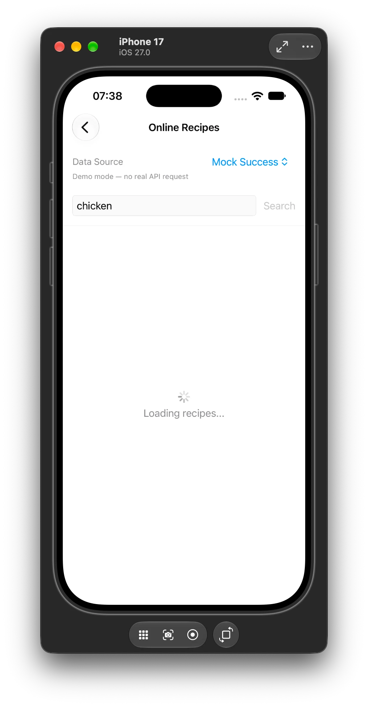 | 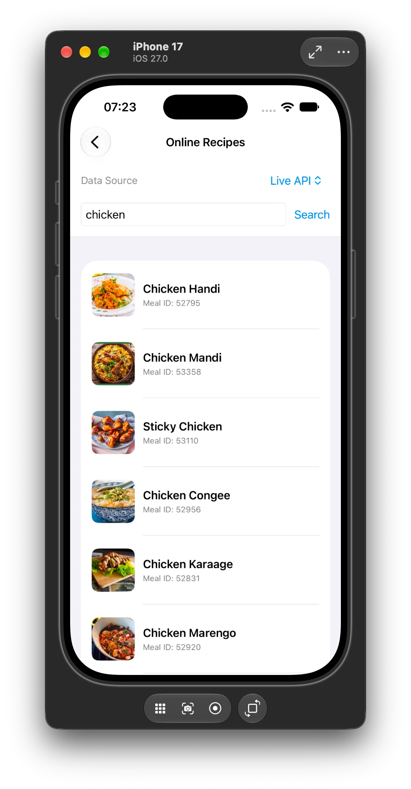 | 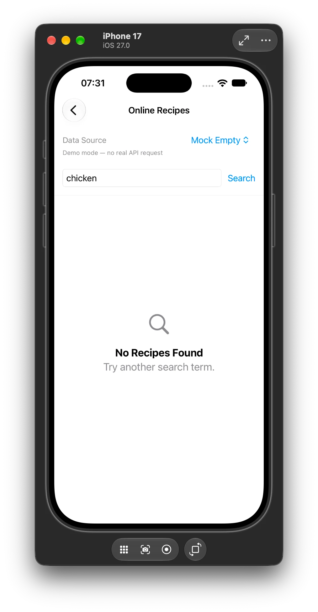 |

| Transport error | HTTP error | Decoding error |
| --- | --- | --- |
| 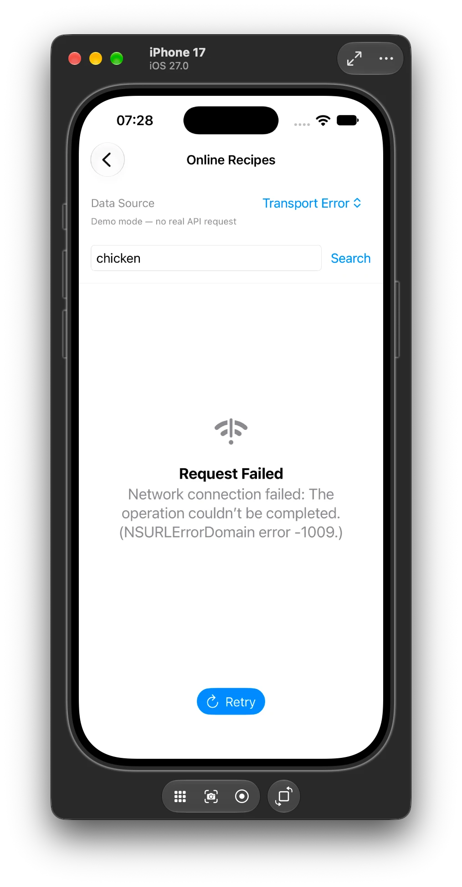 | 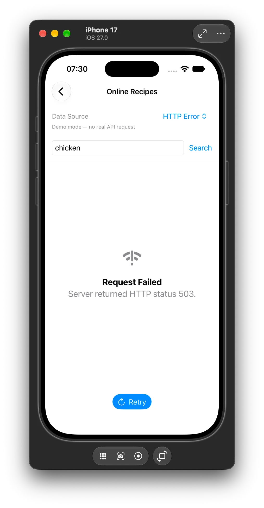 |  |

**Screenshot evidence** documents visible states; verify the actual execution on devices separately. For a visible Loading screenshot, a mock mode with deliberate delay may be easier than a fast live request.

## 7. Practical Work 4 team contributions

- **Bohdana — API and Network:** `RemoteMeal`, `MealSearchResponse`, `HTTPClientProtocol`, `URLSessionHTTPClient`, `NetworkError`, `OnlineRecipeServiceProtocol`, `TheMealDBService`. Branch: `feature/network-api`.
- **Yevhenii — async state and test doubles:** `OnlineRecipesViewModel`, `OnlineRecipesState`, `MockOnlineRecipeService`, five mock scenarios, retry logic and `@MainActor` state management. Branch: `feature/online-recipes-state`.
- **Nadiia — UI and integration:** `OnlineRecipesView`, Search, loading/empty/error/success presentation, data-source Picker, navigation and dependency wiring, simulator screenshots. Branch: `feature/online-recipes-ui`.

**Outcome:** Real server-backed meal search is separated from SwiftUI via protocols and DI. Loading, successful data, empty response and errors can be displayed, with a Retry action for failures.

---

# UI implementation

After Practical Work 4 the interface was extended in two steps:

1. **Online recipe details** — recipes from TheMealDB became clickable and open a full recipe screen.
2. **UI redesign** — a new home screen, tab bar, fridge-based search, favorites and cooking history, based on Figma wireframes.

## 1. Online recipe details

`RemoteMeal` was extended with the full recipe data returned by `search.php`, so no extra request is needed:

| Field | Source in JSON | Shown as |
| --- | --- | --- |
| `strInstructions` | `strInstructions` | Numbered steps |
| `strCategory`, `strArea` | `strCategory`, `strArea` | Tags, e.g. *Chicken · India* |
| `ingredients: [RemoteIngredient]` | `strIngredient1…20` + `strMeasure1…20` | Ingredient list with measures and photos |

TheMealDB stores ingredients as 20 flat pairs of fields, many of them empty. A custom `init(from:)` with a dynamic `CodingKey` collects the non-empty pairs into one array. `RemoteMeal` is also `Encodable` (written back in the same flat format), so meals can be saved on the device.

`RemoteIngredient.imageURL` builds the TheMealDB ingredient photo URL (`/images/ingredients/<name>-small.png`), used both in recipes and in My Fridge.

`OnlineRecipeDetailView` shows the meal photo, title, tags, ingredients and instruction steps (lines such as `STEP 1` are filtered out). It is opened through a new route:

```swift
case onlineRecipeDetails(RemoteMeal)   // AppRoute
```

Back navigation is the standard `NavigationStack` path, so **Back** returns to the list the recipe was opened from.

## 2. Redesign: from wireframes to SwiftUI

The Figma frames were treated as a structural skeleton, not a pixel-perfect spec. The final UI keeps the structure (intro card, online search, ingredient circles, *Previous meals* carousel, fridge list with *Show recipe*, bottom bar with ♡ / ＋ / profile) and adds a consistent visual style:

- **Accent color:** fresh green (`AccentColor` asset) with a separate dark-mode shade; lavender-to-green gradient on the intro card.
- **Cards:** large rounded corners (continuous), soft shadows, photo-first meal cards. Technical details such as meal IDs are hidden; category and cuisine are shown instead.
- **Real images:** meal photos and TheMealDB ingredient photos, with a letter/icon placeholder while loading.
- **System behaviour:** Dynamic Type fonts, light and dark mode, SF Symbols with symbol transitions, haptic feedback for Cook and Favorite, accessibility labels on icon-only buttons.

### Navigation map

```text
MainTabView (custom bottom bar)
├── Home ── FridgeHomeView
│     ├── Search field ─────────────→ OnlineRecipesView(query) → OnlineRecipeDetailView
│     ├── My Fridge circles / "›" ──→ Fridge tab
│     ├── "+" circle ───────────────→ AddIngredientView (.sheet)
│     └── Previous meals card / "›" → OnlineRecipeDetailView / PreviousMealsView
├── Favorites ── FavoritesView ─────→ OnlineRecipeDetailView
├── ＋ (center) ────────────────────→ AddIngredientView (.sheet)
├── Fridge ── MyFridgeView
│     └── select ingredients → Show recipes → IngredientRecipesView
│                                              ├── local recipe  → RecipeDetailView
│                                              └── online recipe → OnlineRecipeDetailView
└── Profile ── ProfileView ─────────→ PreviousMealsView
```

All screens share one `NavigationStack(path: router.path)`. The tab content is the root of the stack; detail screens are pushed on top and hide the bottom bar. `AppRouter` gained `selectedTab` and new routes:

```swift
enum AppRoute: Hashable {
    case recipes
    case recipeDetails(String)
    case onlineRecipes(query: String)
    case onlineRecipeDetails(RemoteMeal)
    case ingredientRecipes([String])
    case previousMeals
}
```

### Screens

| Screen | File | Purpose |
| --- | --- | --- |
| Tab container | `Views/MainTabView.swift` | Switches tab content, adds `AppBottomBar` |
| Home | `Views/FridgeHomeView.swift` | Intro card, online search, fridge circles, Previous meals |
| My Fridge | `Views/MyFridgeView.swift` | Select / swipe-delete ingredients, *Show recipes (n)* |
| Recipes for you | `Views/IngredientRecipesView.swift` | Online + local recipes for the selected ingredients |
| Online Recipes | `Views/OnlineRecipesView.swift` | Search by name; data-source menu for Practical 4 mocks |
| Recipe | `Views/OnlineRecipeDetailView.swift` | Photo, tags, ingredients, steps, ♡ and **Cook this** |
| Favorites | `Views/FavoritesView.swift` | Two-column grid of saved recipes |
| Previous meals | `Views/PreviousMealsView.swift` | Full cooking history |
| Profile | `Views/ProfileView.swift` | Basic profile: stats and *Clear cooking history* |
| Shared UI | `Views/Components/DesignComponents.swift` | `MealCard`, `MealRow`, `IngredientAvatar`, `SectionHeader`, `SearchField`, `EmptyStateCard`, `AppBottomBar` |

## 3. Cooking from the fridge

`FridgeViewModel` now keeps `selectedIngredients` (`toggleSelection`, `selectAll`, `clearSelection`). **Show recipes** opens `IngredientRecipesView`, driven by `IngredientRecipesViewModel` (`@MainActor`, reuses `OnlineRecipesState`).

The free TheMealDB API filters by **one** ingredient per request and returns short records, so `TheMealDBService.searchMeals(containing:)` works in three steps:

```text
for each selected ingredient → filter.php?i=<ingredient>  → set of meal IDs
intersect the sets           → meals that contain ALL ingredients
first 12 IDs                 → lookup.php?i=<id> (concurrently, TaskGroup) → full RemoteMeal
```

`OnlineRecipeServiceProtocol` gained this method, and `MockOnlineRecipeService` implements it with the same five scenarios, so DI and mock substitution from Practical 4 still work. Local recipes for the same selection come from the existing `RecipeService` → `FridgeManager` → `ExactMatchStrategy` chain.

## 4. Favorites and Previous meals

`MealLibrary` (`Services/MealLibrary.swift`) is a `@MainActor ObservableObject` shared through `.environmentObject`:

| Action | Result |
| --- | --- |
| ♡ on the recipe screen | `toggleFavorite(_:)` → Favorites tab |
| **Cook this** | `markCooked(_:)` → moved to the top of *Previous meals* (no duplicates) |
| Profile → *Clear cooking history* | `clearPreviousMeals()` after confirmation |

Both lists are encoded with `JSONEncoder` and saved in `UserDefaults`, so they survive an app restart. `MealLibrary` is created in `Fridge2PlateApp` (composition root) and injected into `ContentView`, like the other services.

## 5. UI screenshots

Screenshots of the running app (iPhone 17 Simulator, iOS 27) are in [`docs/ui-view/`](docs/ui-view).

| Home — first launch | Home — with cooked meals | Add Ingredient |
| --- | --- | --- |
| 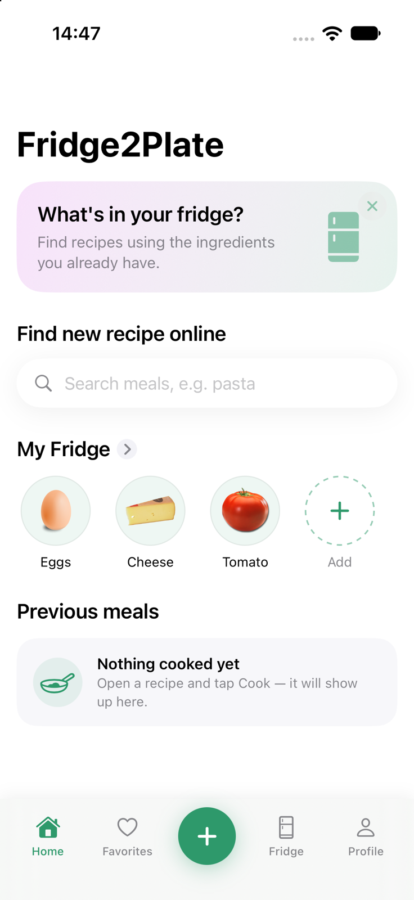 | 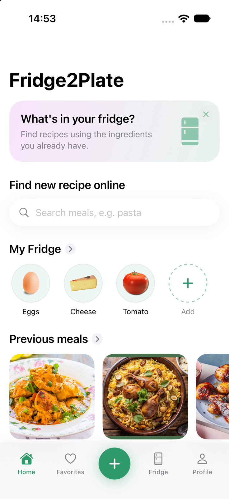 | 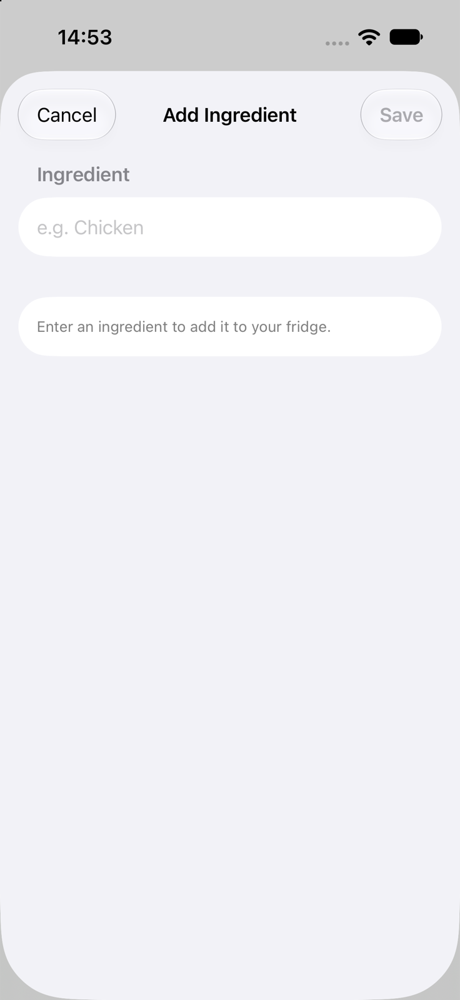 |

| My Fridge — selection | Recipes for selected ingredients | Online search |
| --- | --- | --- |
| 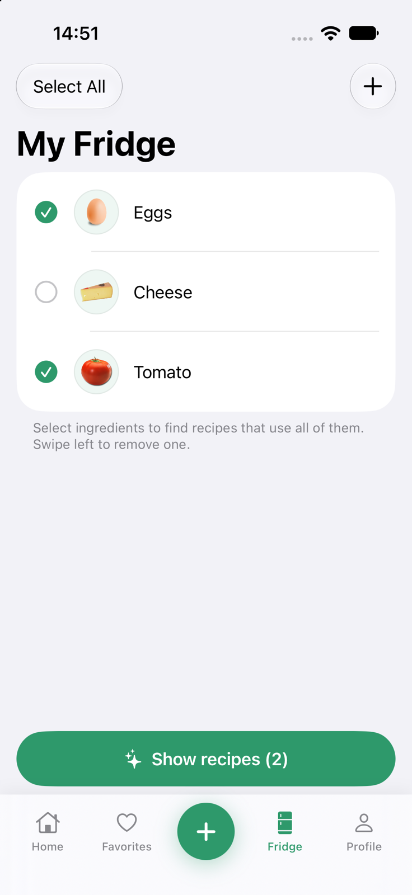 | 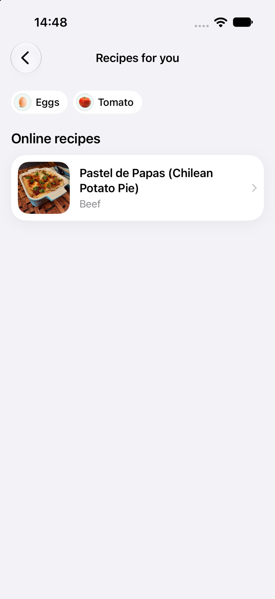 | 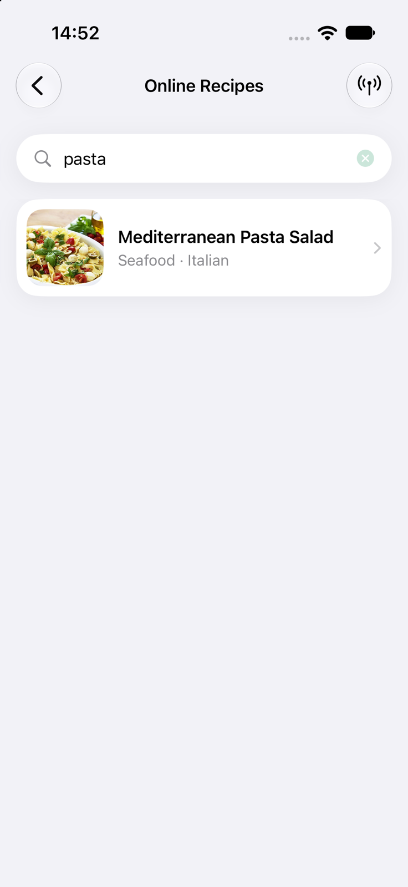 |

| Recipe details | Favorites | Profile |
| --- | --- | --- |
| 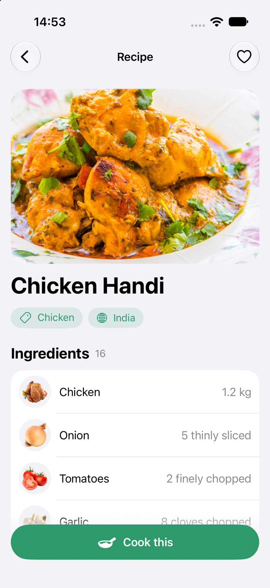 | 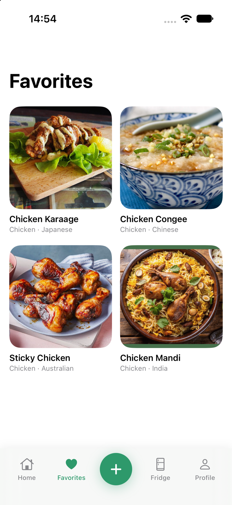 | 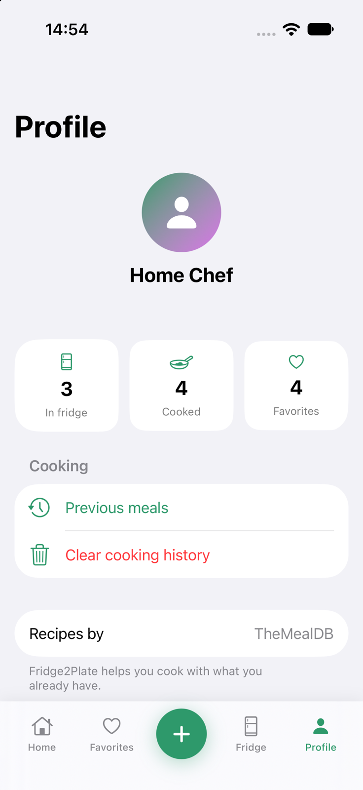 |

| Home — dark mode | Recipe — dark mode |
| --- | --- |
| 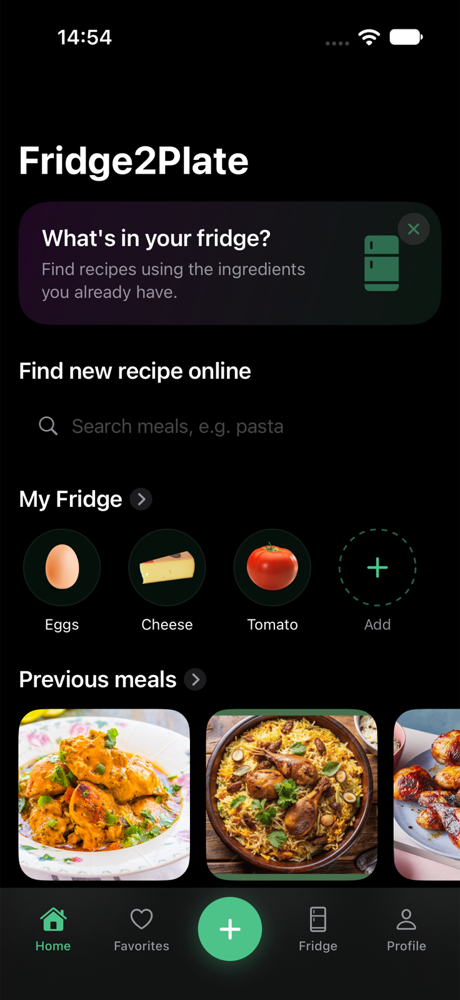 | 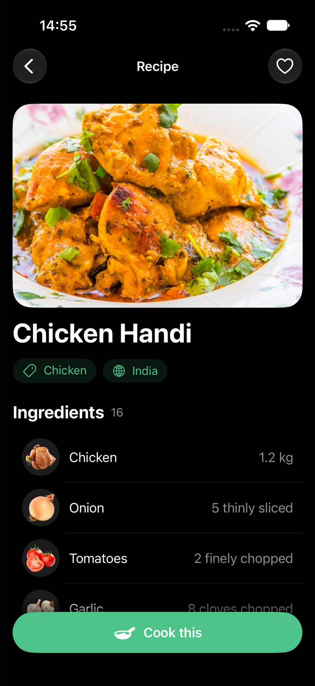 |

## 6. How to verify the new UI

1. Launch the app: Home shows the intro card, search, *My Fridge* circles and an empty *Previous meals* card.
2. Type `pasta` in **Find new recipe online** and press Search → results with photo, category and cuisine.
3. Open a recipe → ingredients with measures and photos, numbered instructions. **Back** returns to the results.
4. Tap ♡ → the recipe appears in **Favorites**. Tap **Cook this** → it appears in **Previous meals** on Home.
5. Open **Fridge**, tick *Eggs* and *Tomato*, tap **Show recipes (2)** → online recipes that use both ingredients.
6. Tap the green **＋** → Add Ingredient sheet; the new ingredient appears in the fridge circles and list.
7. Open **Profile** → counters update; *Clear cooking history* empties *Previous meals*.
8. Restart the app → favorites and cooking history are still there.
9. Online Recipes → antenna icon → choose a mock scenario: all Practical 4 states (Loading, Empty, errors, Retry) still work.

**Team:** Nadiia — recipe details (`feature/online-recipe-details`), UI redesign (`feature/home-redesign`), screenshots and documentation (`feature/readme-ui-update`).

---

# Project structure (current)

```text
Fridge2Plate/
├── Fridge2Plate.xcodeproj/
├── Fridge2Plate/
│   ├── Models/
│   │   ├── Category.swift
│   │   ├── Displayable.swift
│   │   ├── Ingredient.swift
│   │   ├── Recipe.swift
│   │   └── RemoteMeal.swift          # + RemoteIngredient, Codable
│   ├── Navigation/
│   │   └── AppRouter.swift
│   ├── Network/
│   │   ├── HTTPClientProtocol.swift
│   │   ├── NetworkError.swift
│   │   └── URLSessionHTTPClient.swift
│   ├── Services/
│   │   ├── FridgeManager.swift
│   │   ├── RecipeServiceProtocol.swift
│   │   ├── RecipeService.swift
│   │   ├── MockRecipeService.swift
│   │   ├── OnlineRecipeServiceProtocol.swift
│   │   ├── TheMealDBService.swift
│   │   ├── MockOnlineRecipeService.swift
│   │   └── MealLibrary.swift         # favorites + cooking history
│   ├── ViewModels/
│   │   ├── FridgeViewModel.swift
│   │   ├── OnlineRecipesViewModel.swift
│   │   └── IngredientRecipesViewModel.swift
│   ├── Views/
│   │   ├── Components/
│   │   │   └── DesignComponents.swift
│   │   ├── ContentView.swift
│   │   ├── MainTabView.swift
│   │   ├── FridgeHomeView.swift      # Home
│   │   ├── MyFridgeView.swift
│   │   ├── IngredientRecipesView.swift
│   │   ├── RecipeListView.swift
│   │   ├── RecipeDetailView.swift
│   │   ├── AddIngredientView.swift
│   │   ├── OnlineRecipesView.swift
│   │   ├── OnlineRecipeDetailView.swift
│   │   ├── FavoritesView.swift
│   │   ├── PreviousMealsView.swift
│   │   └── ProfileView.swift
│   ├── Patterns/
│   │   ├── Builder/RecipeBuilder.swift
│   │   ├── Adapter/LegacyRecipe.swift
│   │   ├── Adapter/RecipeAdapter.swift
│   │   ├── Strategy/RecipeSearchStrategy.swift
│   │   ├── Strategy/ExactMatchStrategy.swift
│   │   └── Strategy/MissingIngredientsStrategy.swift
│   ├── Assets.xcassets/
│   └── Fridge2PlateApp.swift
├── docs/
│   ├── practical-3/screenshots/
│   ├── practical-4/screenshots/
│   └── ui-view/
├── .gitignore
└── README.md
```

# How to run

**Requirements:** macOS, Xcode with an installed iOS Simulator and internet access for Live API mode.

```bash
git clone https://github.com/yellowBlackie/Fridge2Plate.git
cd Fridge2Plate
open Fridge2Plate.xcodeproj
```

1. Select an available iPhone Simulator in Xcode.
2. **Command + B** — build; **Command + R** — run.
3. On **Home**, type a meal name (e.g. `chicken`) in **Find new recipe online** and press Search.
4. Open a recipe, try ♡ and **Cook this**, then check **Favorites** and **Previous meals**.
5. In the **Fridge** tab select ingredients and tap **Show recipes**.
6. For the Practical 4 mock scenarios, open Online Recipes and use the antenna icon (data-source menu); use Retry on errors.

No additional backend, database, environment variable or user account is required for the educational setup. TheMealDB test key `1` is part of the public v1 path; this is **not a secret production credential**.

## Testing notes and limitations

- Fridge ingredients and the two local demonstration recipes are still in memory and reset after a full restart. Favorites and cooking history are saved in `UserDefaults`.
- *Show recipes* intersects one-ingredient filters of the free API and loads full details for the first 12 matches. Ingredient names must match TheMealDB names (e.g. `Eggs`, `Tomato`); selecting many ingredients often gives no common recipe.
- Online recipes are not imported into the local `FridgeManager`.
- Remote meal images are displayed through `AsyncImage`, separate from the JSON search request.
- The code contains the UI for retry and controlled failures, but a screenshot cannot establish whether every test was performed on two real simulator sizes. Record simulator checks before claiming verified coverage.
- `Task.sleep` in mock services is intentional for visualization; production network timing depends on connectivity.
- A public App Store release should use appropriate TheMealDB production access, not the educational test key.

# Git and submission

Workflow: feature branches → commits → GitHub Pull Requests → merge to `main` → final verification → annotated tag.

| Work | Main branches |
| --- | --- |
| 1 | `feature/models`, `feature/fridge-manager`, `feature/demo-scenario` |
| 2 | `feature/mvvm-architecture`, `feature/service-strategy`, `feature/adapter-integration` |
| 3 | `feature/navigation-router`, `feature/ingredient-state`, `feature/swiftui-screens` |
| 4 | `feature/network-api`, `feature/online-recipes-state`, `feature/online-recipes-ui` |
| UI | `feature/online-recipe-details`, `feature/home-redesign`, `feature/readme-ui-update` |

The practical works are available under tags `practical-1`, `practical-2`, `practical-3` `practical-4`.

# Defense topics

**Work 1:** Swift models, Optional, `struct` vs `class`, collections, Git.  
**Work 2:** MVVM, Builder/Adapter/Strategy, SOLID, DI vs DIP, mock substitution.  
**Work 3:** Router, stack vs modal navigation, passing a recipe, `@Published` and animation.  
**Work 4:** HTTP request anatomy; transport vs HTTP errors; JSONDecoder; `async/await` and `@MainActor`; service abstraction/DI; reproducible mock scenarios; Retry and real API verification.  
**UI:** custom `Decodable` with dynamic keys; one `NavigationStack` with a custom tab bar; routes with associated values; `TaskGroup` for parallel requests; `@EnvironmentObject` and `UserDefaults` persistence; wireframe-to-SwiftUI design decisions.

---

**Summary:** Four practical works progressively built a small iOS application with local domain logic, modular architecture, navigation and animations, and a real remote meal search. The UI stage turned it into a complete recipe app: full online recipes, cooking from selected fridge ingredients, favorites and cooking history, in a redesigned interface. HTTP operations remain separated from the SwiftUI presentation layer.
