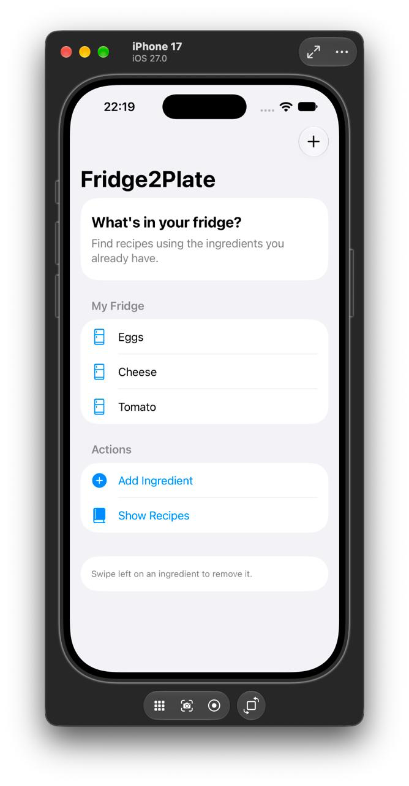
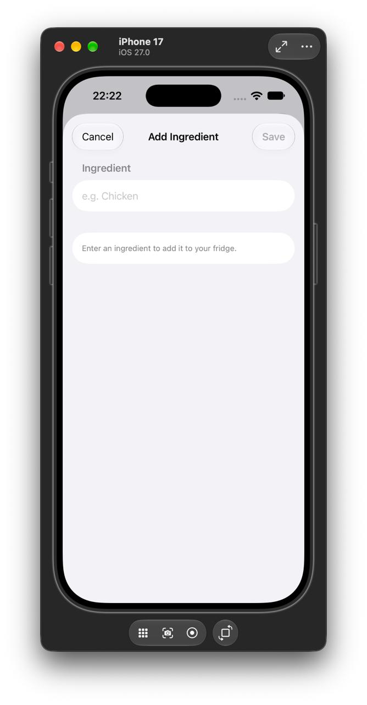
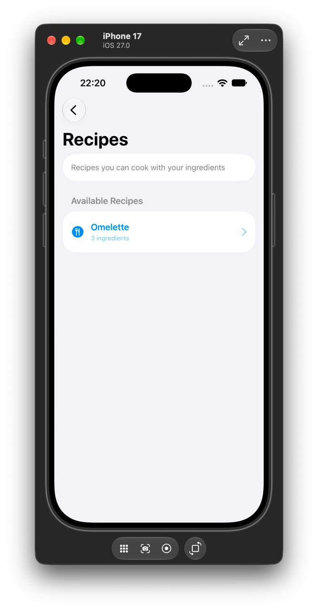
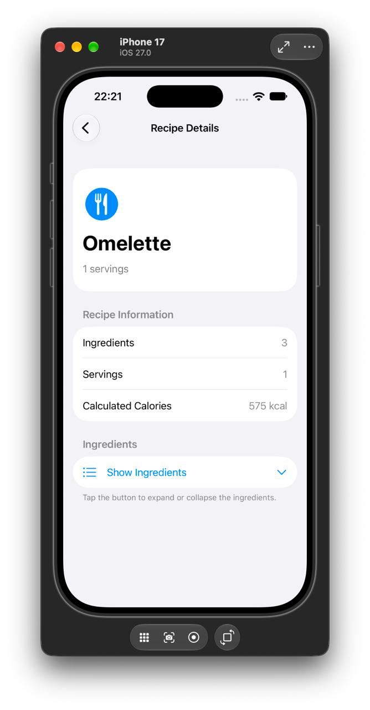
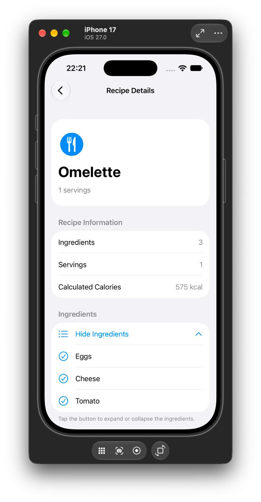

# Fridge2Plate

**Fridge2Plate** is an iOS application that helps users find recipes based on the ingredients they already have at home.

The application allows users to manage ingredients in their fridge, discover available recipes, view recipe details, and update their ingredients through a simple SwiftUI interface.

The project was developed during three practical works covering Swift fundamentals, software architecture, design patterns, SOLID principles, navigation, state management, and animations.

## Team

| Student | Group | Responsibilities |
| --- | --- | --- |
| Bohdana Klimenko | IP-44 | Domain models, MVVM architecture, Builder, navigation Router |
| Nadiia Podkur | IP-41 | SwiftUI interface, Adapter, animations, Xcode integration and testing |
| Yevhenii Naumenko | IP-44 | Business logic, services, Strategy, dependency injection, ingredient state management, Git and documentation |

## Technologies

- Swift
- SwiftUI
- Combine
- Xcode
- iOS Simulator
- MVVM architecture
- Router-based navigation
- Design patterns: Builder, Adapter, Strategy
- SOLID principles
- Git and GitHub

---

# Project Overview

## Domain

Fridge2Plate works with two main domain entities: **ingredients** and **recipes**.

An ingredient contains a name, category, and optional calorie information.

A recipe contains a name, a collection of required ingredients, the number of servings, and methods for calculating calories.

The application compares the ingredients available to the user with those required by each recipe.

## Target User

The target user is a person who wants to decide what to cook using products already available at home.

Fridge2Plate allows users to:

- View ingredients currently available in the fridge.
- Add new ingredients.
- Remove existing ingredients.
- Find recipes based on available products.
- Open recipe details.
- View ingredient lists and calorie information.
- Navigate between screens without losing the current session state.

## Main User Scenario

Initially, the fridge contains:

```text
Eggs
Cheese
Tomato
```

The application contains two demo recipes:

| Recipe | Required Ingredients |
| --- | --- |
| Omelette | Eggs, Cheese, Tomato |
| Chicken Omelette | Eggs, Cheese, Chicken |

With the default `ExactMatchStrategy`, only **Omelette** is available.

After the user adds `Chicken`, the available recipes are:

```text
Omelette
Chicken Omelette
```

If Chicken is removed, Chicken Omelette disappears from the available recipe list.

This scenario demonstrates ingredient management, recipe filtering, state updates, and multi-screen navigation.

---

# Practical Work 1 — Swift Basics and Domain Logic

## Goal

The goal of Practical Work 1 was to create an initial iOS application, configure Git and GitHub, implement basic Swift concepts, and demonstrate a complete domain scenario.

## Implemented Functionality

During Practical Work 1, the team implemented:

- Xcode project configuration.
- Git repository and `.gitignore`.
- Domain models.
- Ingredient categories.
- Recipe storage.
- Recipe filtering.
- Optional calorie values.
- Collection processing.
- Minimal SwiftUI interface.
- A working recipe-search demonstration.
- Xcode and iOS Simulator verification.

## Domain Models

### Ingredient

`Ingredient` represents a food product.

Properties:

- `name: String`
- `category: Category`
- `calories: Double?`

File:

`Fridge2Plate/Models/Ingredient.swift`

### Recipe

`Recipe` represents a recipe.

It stores:

- Recipe name.
- Required ingredients.
- Base servings.

It also provides methods for calculating total calories and calories for a selected number of servings.

File:

`Fridge2Plate/Models/Recipe.swift`

### Category

`Category` is an enum representing ingredient categories.

File:

`Fridge2Plate/Models/Category.swift`

### Displayable

`Displayable` is a protocol defining a common requirement for objects that expose a displayable name.

File:

`Fridge2Plate/Models/Displayable.swift`

## Swift Concepts

| Requirement | Implementation |
| --- | --- |
| `struct` | Ingredient, Recipe |
| `class` | FridgeManager |
| `protocol` | Displayable |
| `enum` | Category |
| `let` and `var` | Models, business logic and demo data |
| Properties and methods | Models and manager |
| Initializers | Domain models and services |
| Collections | Arrays of ingredients and recipes |
| Optional values | Optional calorie information |
| Safe unwrapping | `guard let`, `if let` |
| Conditions | `if`, `else`, `guard` |
| Collection processing | `map`, `filter`, `allSatisfy` |

## Original Recipe-Search Scenario

The first version used `FridgeManager` to store recipes and filter them by available ingredients.

```text
Available Ingredients
         |
         v
    FridgeManager
         |
         v
    Recipe Filtering
         |
         v
    Available Recipes
         |
         v
      SwiftUI
```

For example:

```text
Available ingredients:
Eggs, Cheese, Tomato

Result:
Omelette
```

Chicken Omelette was not displayed because Chicken was unavailable.

This demonstrated a complete domain scenario using basic Swift functionality.

## Team Contributions — Practical Work 1

### Bohdana

Responsible for:

- Ingredient model.
- Recipe model.
- Category enum.
- Displayable protocol.
- Optional calorie values.
- Domain model organization.

### Yevhenii

Responsible for:

- FridgeManager.
- Recipe storage and filtering.
- Collection processing.
- Git/GitHub organization.
- Feature branches and Pull Requests.
- README documentation.
- Practical Work 1 Git tag.

### Nadiia

Responsible for:

- SwiftUI demo interface.
- Displaying available ingredients.
- Displaying available recipes.
- Integration of models and business logic.
- Xcode build and testing.
- iOS Simulator demonstration.

## Result

Practical Work 1 established the initial application architecture and a working recipe-search scenario.

**Git tag:** `practical-1`

---

# Practical Work 2 — Architecture, Design Patterns and SOLID

## Goal

The goal of Practical Work 2 was to improve the initial application by introducing a clear architecture, separating responsibilities, implementing design patterns, and demonstrating SOLID principles.

## Selected Architecture — MVVM

The project uses **MVVM (Model–View–ViewModel)**.

MVVM was selected because the application is implemented using SwiftUI and requires separation between the user interface, presentation state, and business logic.

### Architecture Components

**Model**

Represents application data:

- Ingredient
- Recipe
- Category

**View**

Displays data and handles user interactions:

- ContentView
- FridgeHomeView
- RecipeListView
- RecipeDetailView
- AddIngredientView

**ViewModel**

Manages UI-related state and communicates with the service layer:

- FridgeViewModel

**Services**

Provide recipe-related operations:

- RecipeServiceProtocol
- RecipeService
- MockRecipeService
- FridgeManager

## Component Interaction

```text
       SwiftUI Views
             |
             v
      FridgeViewModel
             |
             v
    RecipeServiceProtocol
             |
             v
       RecipeService
             |
             v
       FridgeManager
             |
             v
    RecipeSearchStrategy
             |
       +-----+------+
       |            |
       v            v
   ExactMatch    MissingIngredients
    Strategy         Strategy
```

The application dependencies are created in:

`Fridge2Plate/Fridge2PlateApp.swift`

This file acts as the application's composition root.

## Why MVVM?

MVVM provides several advantages:

- Separates UI from business logic.
- Improves code organization.
- Supports observable UI state.
- Makes ViewModel testing easier.
- Allows services to be replaced.
- Fits naturally with SwiftUI.

A limitation is that ViewModels can become too large as the application grows. For the current project, MVVM provides enough separation without unnecessary complexity.

---

## Design Patterns

Three design patterns from different categories were implemented.

| Category | Pattern | Component |
| --- | --- | --- |
| Creational | Builder | RecipeBuilder |
| Structural | Adapter | RecipeAdapter |
| Behavioral | Strategy | RecipeSearchStrategy |

### 1. Builder — Creational Pattern

**Problem:** Creating a recipe can involve multiple properties and ingredients. Direct initialization may become difficult to read.

**Solution:** `RecipeBuilder` constructs a Recipe step by step.

Example:

```swift
let omelette = RecipeBuilder()
    .setName("Omelette")
    .addIngredient(eggs)
    .addIngredient(cheese)
    .addIngredient(tomato)
    .setBaseServings(1)
    .build()
```

Participants:

- Builder: RecipeBuilder
- Product: Recipe
- Client: Fridge2PlateApp

File:

`Fridge2Plate/Patterns/Builder/RecipeBuilder.swift`

### 2. Adapter — Structural Pattern

**Problem:** A legacy recipe representation may have a different structure from the internal Recipe model.

For example:

```text
LegacyRecipe        Recipe

title          ->   name
items          ->   ingredients
portions       ->   baseServings
```

**Solution:** `RecipeAdapter` converts LegacyRecipe into the application's Recipe model.

```text
LegacyRecipe
     |
     v
RecipeAdapter
     |
     v
   Recipe
```

Participants:

- Adaptee: LegacyRecipe
- Adapter: RecipeAdapter
- Target representation: Recipe
- Client: Fridge2PlateApp

Files:

- `Fridge2Plate/Patterns/Adapter/LegacyRecipe.swift`
- `Fridge2Plate/Patterns/Adapter/RecipeAdapter.swift`

The demo Chicken Omelette is created using LegacyRecipe and converted through RecipeAdapter.

### 3. Strategy — Behavioral Pattern

**Problem:** Recipe searching may require different algorithms.

**Solution:** The application defines the RecipeSearchStrategy protocol and multiple implementations.

Implemented strategies:

**ExactMatchStrategy**

Returns only recipes for which every required ingredient is available.

**MissingIngredientsStrategy**

Allows recipes to be found even when a configured number of ingredients is missing.

Example:

```text
Available:
Eggs, Cheese, Tomato

ExactMatchStrategy:
- Omelette

MissingIngredientsStrategy (maximum missing: 1):
- Omelette
- Chicken Omelette
```

`FridgeManager` delegates searching to the selected strategy.

Participants:

- Strategy: RecipeSearchStrategy
- Concrete strategies: ExactMatchStrategy, MissingIngredientsStrategy
- Context: FridgeManager

Files:

- `Fridge2Plate/Patterns/Strategy/RecipeSearchStrategy.swift`
- `Fridge2Plate/Patterns/Strategy/ExactMatchStrategy.swift`
- `Fridge2Plate/Patterns/Strategy/MissingIngredientsStrategy.swift`

This design allows new search algorithms to be added without changing the core recipe-management logic.

---

## Dependency Injection

FridgeViewModel does not create RecipeService internally.

Instead, it receives the service through its initializer:

```swift
init(recipeService: RecipeServiceProtocol) {
    self.recipeService = recipeService
}
```

This is initializer-based **Dependency Injection (DI)**.

The real service is created externally:

```swift
let recipeService = RecipeService(
    fridgeManager: fridgeManager
)

let viewModel = FridgeViewModel(
    recipeService: recipeService
)
```

The same ViewModel can receive a mock implementation:

```swift
let mockService = MockRecipeService(
    recipes: [omelette]
)

let viewModel = FridgeViewModel(
    recipeService: mockService
)
```

No changes inside FridgeViewModel are required.

### Dependency Injection vs Dependency Inversion

Dependency Injection is a technique for supplying dependencies from outside an object.

Dependency Inversion is a design principle requiring high-level modules to depend on abstractions rather than concrete implementations.

In Fridge2Plate:

```text
             FridgeViewModel
                    |
                    v
         RecipeServiceProtocol
                    ^
                    |
          +---------+---------+
          |                   |
     RecipeService      MockRecipeService
```

---

## SOLID Principles

### S — Single Responsibility Principle

Each component has a focused responsibility.

| Component | Responsibility |
| --- | --- |
| ContentView | Connect UI screens and navigation |
| FridgeViewModel | Manage observable application state |
| RecipeService | Provide recipe-search operations |
| FridgeManager | Store recipes and delegate searching |
| RecipeBuilder | Construct recipes |
| RecipeAdapter | Convert legacy recipes |
| Search strategies | Implement search algorithms |
| AppRouter | Manage navigation state |

### O — Open/Closed Principle

The Strategy pattern allows additional search algorithms to be introduced without modifying existing strategy implementations.

### L — Liskov Substitution Principle

RecipeService and MockRecipeService conform to RecipeServiceProtocol.

They can be substituted where that protocol is expected, provided they satisfy its behavioral contract.

### I — Interface Segregation Principle

The project uses small, focused protocols:

- Displayable
- RecipeServiceProtocol
- RecipeSearchStrategy

Clients depend only on the operations they require.

### D — Dependency Inversion Principle

FridgeViewModel depends on RecipeServiceProtocol rather than a concrete RecipeService implementation.

This reduces coupling and supports dependency substitution.

---

## Anti-Patterns and Improvements

### Excessive Responsibility

In Practical Work 1, ContentView created data, performed business operations, and displayed the result.

In Practical Work 2, these responsibilities were separated between Views, ViewModel, Services, Models, and Patterns.

### Direct UI–Business Logic Coupling

The UI no longer performs recipe filtering directly.

Instead:

```text
SwiftUI View
     |
     v
FridgeViewModel
     |
     v
RecipeServiceProtocol
     |
     v
Business Logic
```

### Hidden Global Dependencies

The application avoids global singleton services and uses explicit dependency creation and injection.

### Duplication

Recipe-search algorithms are separated into Strategy implementations.

Recipe construction and legacy conversion are also isolated in Builder and Adapter components.

---

## Practical Work 2 — Team Contributions

### Bohdana

- Reorganized the project into MVVM-related folders.
- Created FridgeViewModel.
- Separated presentation responsibilities.
- Implemented RecipeBuilder.

Commits:

- `ed646c9` — Create MVVM architecture skeleton
- `40df7d4` — Add Recipe Builder pattern

### Yevhenii

- Created RecipeServiceProtocol.
- Implemented RecipeService.
- Implemented MockRecipeService.
- Added dependency injection.
- Implemented RecipeSearchStrategy.
- Implemented ExactMatchStrategy.
- Implemented MissingIngredientsStrategy.
- Updated FridgeManager to use Strategy.
- Documented SOLID principles.

Commits:

- `970c381` — Add recipe service abstraction and dependency injection
- `d925156` — Add mock recipe service for dependency substitution
- `86f930d` — Add recipe search Strategy pattern

### Nadiia

- Implemented LegacyRecipe.
- Implemented RecipeAdapter.
- Integrated Adapter into the demo scenario.
- Verified the application in Xcode.
- Tested the application in iOS Simulator.

Commit:

- `28c452a` — Add Recipe Adapter pattern

## Result

Practical Work 2 produced a more modular application with:

- MVVM architecture.
- Separated responsibilities.
- Three design pattern categories.
- Dependency Injection.
- Service abstraction.
- Mock dependency substitution.
- SOLID principles.
- Improved maintainability.

**Git tag:** `practical-2`

---

# Practical Work 3 — User Interface, Navigation and Animations

## Goal

The goal of Practical Work 3 was to implement a complete user scenario across several screens, organize navigation through a separate Router, support modal presentation and data transfer, and add animations related to user actions.

The implementation builds on the MVVM architecture from Practical Work 2.

## Implemented Functionality

Practical Work 3 introduced:

- Three main SwiftUI screens.
- An additional modal ingredient form.
- NavigationStack-based navigation.
- A separate navigation Router.
- Data transfer between screens.
- Back navigation.
- Modal presentation and dismissal.
- Ingredient creation and removal.
- Automatic recipe list updates.
- Animated ingredient expansion.
- Form validation.
- Keyboard handling.
- Interface screenshots.

---

## Screens

The application contains three main screens and one modal form.

### 1. FridgeHomeView — My Fridge

The main screen displays ingredients currently available in the fridge.

Features:

- View available ingredients.
- Add an ingredient.
- Remove an ingredient with a swipe gesture.
- Navigate to the recipe list.

File:

`Fridge2Plate/Views/FridgeHomeView.swift`

### 2. RecipeListView — Available Recipes

Displays recipes that can be prepared using the current ingredients.

Features:

- View matching recipes.
- Display ingredient count.
- Open recipe details.
- Display an empty state when no recipes are available.

The screen observes FridgeViewModel, allowing the recipe list to update when the ingredients change.

File:

`Fridge2Plate/Views/RecipeListView.swift`

### 3. RecipeDetailView — Recipe Details

Displays detailed information about the selected recipe.

Features:

- Recipe name.
- Ingredient count.
- Number of servings.
- Calculated calorie information, when available.
- Expandable ingredient list.
- Custom expansion and collapse animation.

File:

`Fridge2Plate/Views/RecipeDetailView.swift`

### 4. AddIngredientView — Modal Form

A modal form that allows the user to add an ingredient.

Features:

- Ingredient name input.
- Save and Cancel buttons.
- Empty-name validation.
- Duplicate ingredient validation.
- Keyboard dismissal.
- Automatic closing after successful creation.

File:

`Fridge2Plate/Views/AddIngredientView.swift`

---

## Navigation Architecture — Router

The project uses a separate AppRouter to manage navigation.

File:

`Fridge2Plate/Navigation/AppRouter.swift`

The Router manages:

- Navigation path.
- Opening the recipe list.
- Opening recipe details.
- Opening the ingredient creation sheet.
- Dismissing the modal sheet.
- Returning to previous screens.
- Returning to the root screen.

It uses two route definitions:

**AppRoute**

Represents stack navigation destinations:

```swift
enum AppRoute: Hashable {
    case recipes
    case recipeDetails(String)
}
```

**AppSheet**

Represents modal destinations:

```swift
enum AppSheet: String, Identifiable {
    case addIngredient

    var id: String {
        rawValue
    }
}
```

The navigation path and active sheet are observable properties:

```swift
@Published var path: [AppRoute] = []
@Published var activeSheet: AppSheet?
```

ContentView connects the Router to NavigationStack and the modal presentation.

---

## Navigation Map

```text
                    FridgeHomeView
                      (My Fridge)
                           |
               +-----------+-----------+
               |                       |
               v                       v
         Show Recipes             Add Ingredient
               |                       |
               v                       v
        RecipeListView         AddIngredientView
               |                (Modal Sheet)
               |                       |
               |                +------+------+
               |                |             |
               |              Save          Cancel
               |                |             |
               |                v             v
               |          Update State    Close Sheet
               |                |
               |                v
               |          Recalculate
               |            Recipes
               |                |
               |                v
               |          Return to
               |          My Fridge
               |
               v
        Select a Recipe
               |
               v
       RecipeDetailView
               |
               +---- Show / Hide Ingredients
               |       (Custom Animation)
               |
               v
         Back to Recipes
               |
               v
          Back to Fridge
```

### Stack Navigation

NavigationStack is used for transitions between:

```text
FridgeHomeView
      |
      v
RecipeListView
      |
      v
RecipeDetailView
```

The user can return using the standard Back button.

### Modal Navigation

The Add Ingredient form is presented using `.sheet`.

Unlike stack navigation, the modal temporarily appears above the current interface.

The user can complete the form or cancel it without modifying the navigation stack.

---

## Data Transfer Between Screens

When a user selects a recipe, AppRouter receives the Recipe object.

The Router stores the recipe name as the identifier for the current demo navigation route.

```swift
func showRecipeDetails(_ recipe: Recipe) {
    path.append(.recipeDetails(recipe.name))
}
```

ContentView resolves the selected recipe from the available recipe collection and passes the Recipe object to RecipeDetailView.

This allows the details screen to display the selected recipe's data.

In the current demo, recipe names are unique. A larger application could use stable UUID identifiers.

---

## Ingredient State Management

FridgeViewModel manages the available ingredients and recipes.

Observable properties:

```swift
@Published var availableIngredients: [String]
@Published var availableRecipes: [Recipe] = []
```

The ViewModel provides three important methods:

- `addIngredient(_:)`
- `removeIngredient(_:)`
- `findAvailableRecipes()`

### Adding an Ingredient

The user enters an ingredient name in AddIngredientView.

The form calls:

```swift
viewModel.addIngredient(name)
```

The ViewModel:

1. Removes unnecessary whitespace.
2. Checks for an empty name.
3. Prevents duplicate ingredients.
4. Adds the ingredient.
5. Recalculates available recipes.
6. Publishes the updated state.

After successful creation, the modal closes.

### Removing an Ingredient

The main screen supports swipe-to-delete.

The selected ingredient is passed to:

```swift
viewModel.removeIngredient(name)
```

The ViewModel removes the ingredient and recalculates the available recipes.

### Automatic UI Updates

Because the ViewModel uses `@Published`, SwiftUI observes state changes and updates the interface.

The user does not need to restart the application.

---

## Custom Animation

Practical Work 3 includes a custom animation in RecipeDetailView.

The implementation uses:

```swift
@State private var showIngredients = false
```

The user can expand or collapse the ingredient list.

The state change is animated using:

```swift
withAnimation(.easeInOut(duration: 0.3)) {
    showIngredients.toggle()
}
```

Ingredient rows use opacity and movement transitions.

This is a user-triggered state animation, not just a standard navigation transition.

The implementation also considers the system Reduce Motion preference.

---

## Complete User Scenario

The following scenario demonstrates the main functionality of Practical Work 3.

### Step 1 — Open the Application

Launch Fridge2Plate.

The main screen displays:

```text
My Fridge

Eggs
Cheese
Tomato
```

### Step 2 — View Available Recipes

Tap **Show Recipes**.

The application displays:

```text
Available Recipes

Omelette
```

Chicken Omelette is unavailable because Chicken is missing.

### Step 3 — View Recipe Details

Tap **Omelette**.

The Recipe Details screen opens.

The user can view the recipe name, number of servings, ingredient count, and calculated calories.

### Step 4 — Demonstrate the Animation

Tap **Show Ingredients**.

The ingredient list expands with an animation.

Tap **Hide Ingredients**.

The list collapses.

### Step 5 — Return to the Main Screen

Use the Back button to return to Recipes, then back to My Fridge.

### Step 6 — Add an Ingredient

Tap **Add Ingredient**.

The modal form opens.

Enter:

```text
Chicken
```

Tap **Save**.

The form closes and Chicken appears in the fridge.

### Step 7 — Check Updated Recipes

Open **Show Recipes** again.

The application now displays:

```text
Omelette
Chicken Omelette
```

The list updates without restarting the application.

### Step 8 — Open Chicken Omelette

Select **Chicken Omelette**.

The details screen opens with information about the selected recipe.

Return to the previous screen.

### Step 9 — Remove Chicken

Return to My Fridge.

Swipe left on Chicken and delete it.

The ingredient disappears.

Open Recipes again.

The available list returns to:

```text
Omelette
```

This demonstrates correct state management and recipe recalculation.

---

## Interface Screenshots

Screenshots of the implemented interface are stored in:

`docs/practical-3/screenshots/`

### 1. Fridge Home Screen



The main screen displays available ingredients and navigation actions.

### 2. Add Ingredient Modal



The modal form allows the user to enter a new ingredient.

### 3. Available Recipes



The recipe list displays recipes matching the current fridge ingredients.

### 4. Recipe Details



The details screen displays information about the selected recipe.

### 5. Expanded Ingredients



The expanded ingredient section demonstrates the animated UI state.

---

## Interface Testing

The application should be checked on at least two different iPhone Simulator sizes.

Testing covers:

| Test Case | Expected Result |
| --- | --- |
| Launch application | Main screen displays correctly |
| Open Recipes | Recipe list appears |
| Open Recipe Details | Selected recipe is displayed |
| Back navigation | Previous screen opens |
| Open Add Ingredient | Modal form appears |
| Save Chicken | Ingredient is added |
| Reopen Recipes | Chicken Omelette becomes available |
| Delete Chicken | Recipe list is recalculated |
| Empty input | Save is unavailable |
| Duplicate ingredient | Validation error appears |
| Cancel modal | Form closes without changes |
| Expand ingredients | Animated list appears |
| Collapse ingredients | Animated list disappears |
| Repeated navigation | Navigation remains consistent |
| Keyboard interaction | Input and completion actions remain accessible |
| Different screen sizes | UI remains readable without overlapping elements |

The interface should be verified on both compact and large iPhone simulators before final submission.

### State Persistence

The current application uses local in-memory demo data.

Ingredient changes remain available while navigating during the current application session.

The demo data is recreated when the application is completely restarted.

Persistent storage is outside the scope of Practical Work 3.

---

## Practical Work 3 — Team Contributions

### Bohdana — Navigation Architecture

Responsible for:

- Designing navigation structure.
- Creating AppRouter.
- Defining AppRoute and AppSheet.
- Implementing navigation path management.
- Connecting NavigationStack.
- Adding stack navigation.
- Adding initial modal presentation.

Branch:

`feature/navigation-router`

Commit:

`639583c` — Add navigation router and SwiftUI navigation flow

### Yevhenii — Ingredient State Management

Responsible for:

- Implementing addIngredient().
- Implementing removeIngredient().
- Validating ingredient names.
- Preventing duplicate ingredients.
- Recalculating available recipes.
- Managing observable ViewModel state.

Branch:

`feature/ingredient-state`

Commit:

`c439bb2` — Add ingredient state management and recipe updates

### Nadiia — SwiftUI Screens and Animations

Responsible for:

- Implementing FridgeHomeView.
- Implementing RecipeListView.
- Implementing RecipeDetailView.
- Implementing AddIngredientView.
- Integrating screens with AppRouter.
- Implementing modal form interactions.
- Implementing ingredient expansion animation.
- Handling keyboard interaction.
- Integrating and verifying the application in Xcode.
- Adding interface screenshots.

Branch:

`feature/swiftui-screens`

Commit:

`b9d6e71` — Implement SwiftUI screens and animated navigation flow

## Result

Practical Work 3 extended Fridge2Plate with:

- Multi-screen navigation.
- A separate Router.
- Stack-based transitions.
- Modal presentation.
- Data transfer between screens.
- Dynamic ingredient management.
- Automatic recipe updates.
- Custom state-based animation.
- A complete connected user scenario.

The final version is intended to be marked with the `practical-3` Git tag after documentation and verification are completed.

---

# Current Project Structure

```text
Fridge2Plate/
├── Fridge2Plate.xcodeproj/
│
├── Fridge2Plate/
│   ├── Models/
│   │   ├── Category.swift
│   │   ├── Displayable.swift
│   │   ├── Ingredient.swift
│   │   └── Recipe.swift
│   │
│   ├── Navigation/
│   │   └── AppRouter.swift
│   │
│   ├── Views/
│   │   ├── ContentView.swift
│   │   ├── FridgeHomeView.swift
│   │   ├── RecipeListView.swift
│   │   ├── RecipeDetailView.swift
│   │   └── AddIngredientView.swift
│   │
│   ├── ViewModels/
│   │   └── FridgeViewModel.swift
│   │
│   ├── Services/
│   │   ├── FridgeManager.swift
│   │   ├── RecipeServiceProtocol.swift
│   │   ├── RecipeService.swift
│   │   └── MockRecipeService.swift
│   │
│   ├── Patterns/
│   │   ├── Builder/
│   │   │   └── RecipeBuilder.swift
│   │   │
│   │   ├── Adapter/
│   │   │   ├── LegacyRecipe.swift
│   │   │   └── RecipeAdapter.swift
│   │   │
│   │   └── Strategy/
│   │       ├── RecipeSearchStrategy.swift
│   │       ├── ExactMatchStrategy.swift
│   │       └── MissingIngredientsStrategy.swift
│   │
│   ├── Assets.xcassets/
│   └── Fridge2PlateApp.swift
│
├── docs/
│   └── practical-3/
│       └── screenshots/
│           ├── 01-fridge-home.png
│           ├── 02-add-ingredient.png
│           ├── 03-recipes.png
│           ├── 04-recipe-details.png
│           └── 05-expanded-ingredients.png
│
├── .gitignore
└── README.md
```

---

# How to Run

## Requirements

- macOS
- Xcode
- iOS Simulator

## Steps

1. Clone the repository:

```bash
git clone https://github.com/yellowBlackie/Fridge2Plate.git
```

2. Open the project directory:

```bash
cd Fridge2Plate
```

3. Open `Fridge2Plate.xcodeproj` in Xcode.

4. Select an available iPhone Simulator.

5. Build the project:

```text
Command + B
```

6. Run the application:

```text
Command + R
```

7. Follow the Practical Work 3 user scenario to verify navigation and ingredient management.

---

# Testing Business Logic Separately from UI

The architecture allows the business logic to be tested without launching SwiftUI screens.

For example, FridgeViewModel can receive a MockRecipeService:

```swift
let mockService = MockRecipeService(
    recipes: [omelette]
)

let viewModel = FridgeViewModel(
    recipeService: mockService
)
```

This allows testing of ViewModel behavior without using the real RecipeService.

Search strategies can also be tested separately by passing predefined recipe and ingredient collections directly to them.

---

# Git Workflow

Development is organized using Git and GitHub.

The team uses:

- Separate feature branches.
- Individual commits for development stages.
- Pull Requests for integration.
- The `main` branch for completed changes.
- `.gitignore` for generated files.
- Git tags for completed practical works.

## Practical Work 1 Branches

- `feature/models`
- `feature/fridge-manager`
- `feature/demo-scenario`

## Practical Work 2 Branches

- `feature/mvvm-architecture`
- `feature/service-strategy`
- `feature/adapter-integration`

## Practical Work 3 Branches

- `feature/navigation-router`
- `feature/ingredient-state`
- `feature/swiftui-screens`

---

# Practical Work Versions

| Version | Focus | Git Tag |
| --- | --- | --- |
| Practical Work 1 | Swift basics, models, business logic, SwiftUI demo | `practical-1` |
| Practical Work 2 | MVVM, Builder, Adapter, Strategy, SOLID, Dependency Injection | `practical-2` |
| Practical Work 3 | Navigation, Router, modal forms, state management, animations | `practical-3` (final tag) |

Each practical work builds on the implementation completed in the previous stage.

---

# Defense Topics

## Practical Work 1

- Difference between `struct` and `class`.
- Difference between `let` and `var`.
- Protocols and enums.
- Optional values and safe unwrapping.
- Collection processing.
- Git branches, commits, push and pull.

## Practical Work 2

- Why MVVM was selected.
- Architecture versus design patterns.
- Builder, Adapter and Strategy.
- SOLID principles.
- Dependency Injection versus Dependency Inversion.
- Real and mock service substitution.
- Testing business logic independently of UI.

## Practical Work 3

- Responsibilities of Router or Coordinator.
- Differences between stack and modal navigation.
- Passing data to the next screen.
- Updating previous screens after user actions.
- Observable state management.
- Strong reference cycles in navigation components.
- Testing animations and accessibility.
- Verifying interface behavior on different screen sizes.

---

# Summary

Fridge2Plate was developed incrementally through three practical works.

**Practical Work 1** established the application foundation:

```text
Swift
+
Domain Models
+
Recipe Search
+
SwiftUI Demo
+
Git/GitHub
```

**Practical Work 2** improved the internal architecture:

```text
MVVM
+
Builder
+
Adapter
+
Strategy
+
SOLID
+
Dependency Injection
```

**Practical Work 3** introduced user interaction and navigation:

```text
SwiftUI Screens
+
AppRouter
+
NavigationStack
+
Modal Forms
+
Observable State
+
Custom Animations
```

The result is a small but structured iOS application with clearly separated responsibilities, reusable components, centralized navigation, and a complete recipe-discovery user scenario.
